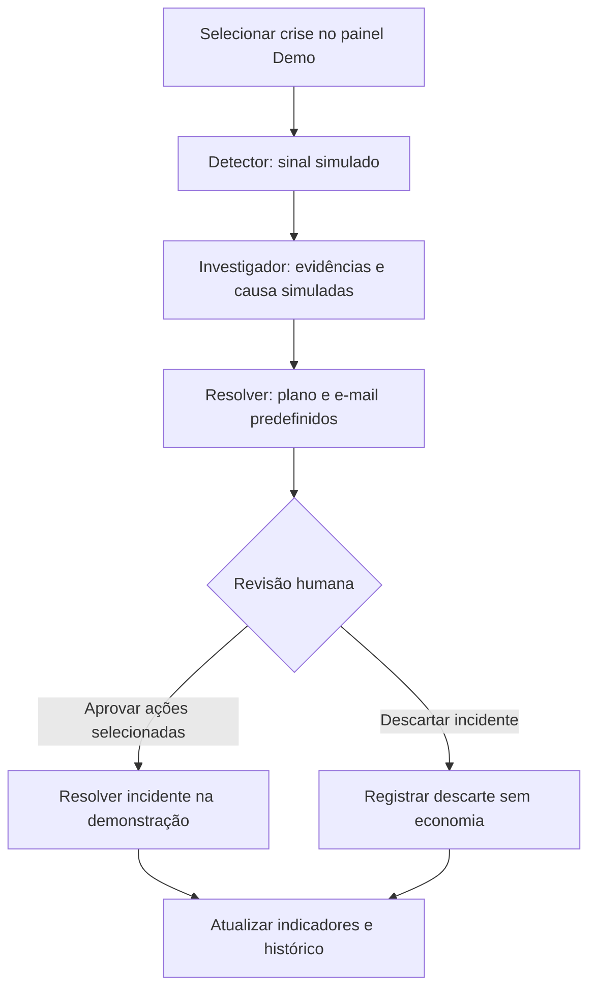

# 🛡️ Sentinel D2C

### Da crise operacional à decisão humana, em um único centro de comando.

Protótipo interativo de gestão de incidentes para **e-commerce D2C** (venda direta ao consumidor), inspirado em sistemas multiagentes: detectar sinais, investigar causas e propor ações sob revisão humana.

[](https://react.dev/)
[](https://www.typescriptlang.org/)
[](https://tanstack.com/start)
[](#-escopo-e-limitações)

**[🚀 Abrir demonstração](https://sentinel-d2c.lovable.app)** · **[🧭 Experimentar o fluxo](#-experimente-em-poucos-passos)** · **[💻 Executar localmente](#-execução-local)**

> [!IMPORTANT]
> Este é um projeto de portfólio, não um sistema em produção. Agentes, evidências, causas, ações e e-mails são simulados com cenários predefinidos. Não há chamadas a modelos de IA nem execução externa de ações. Os valores financeiros são ilustrativos, não resultados comprovados.

## 🧭 Guia de leitura

| Público | O que observar | Onde começar |
| :--- | :--- | :--- |
| **Recrutadores** | Tradução de uma dor de negócio em produto, clareza de escopo e decisões testáveis | Impacto → Criatividade → Qualidade |
| **Estudantes** | Separação entre interface, estado e regras; desenho de um fluxo agêntico | Uso de IA → Organização → Execução local |
| **Entusiastas** | Investigação e aprovação em cenários reproduzíveis | Demonstração → Replicabilidade |

---

## 🎯 1. Impacto

### A dor: sinais dispersos, reação tardia e decisões sem contexto

Um problema de impressão pode aparecer primeiro nas avaliações. Uma falha de estoque pode virar uma promessa de entrega impossível. Uma instabilidade no pagamento pode interromper compras antes de a operação perceber.

O Sentinel reúne **sinal → causa → plano → decisão → histórico**. Em vez de encerrar a experiência no alerta, demonstra o caminho até uma resposta operacional revisável.

| Dor do negócio | Resposta demonstrada | Ganho potencial a validar |
| :--- | :--- | :--- |
| Reclamações sem ligação clara com a origem | Associação simulada entre avaliações, SKU e lote | Antecipar contenção e reduzir novas ocorrências |
| Venda sem cobertura de estoque | Investigação de sincronização e roteamento alternativo | Reduzir atrasos e promessas incorretas |
| Falha no PIX durante o checkout | Diagnóstico simulado e plano de contingência | Reduzir interrupções e apoiar recuperação de vendas |
| Resposta fragmentada entre equipes | Plano, rascunho de e-mail e decisão centralizada | Diminuir troca de contexto e registrar decisões |

### 📊 Impacto na demonstração

| Cenário fictício | Sinal apresentado | Valor ilustrativo do plano completo |
| :--- | :--- | ---: |
| Impressão descascando em capinhas | Aumento de avaliações negativas | R$ 184.300 |
| Ruptura de sérum no centro de distribuição | Pedidos sem cobertura local | R$ 96.750 |
| Queda na aprovação de PIX | Redução da taxa de aprovação | R$ 62.400 |

O indicador **Prejuízo Evitado** soma somente incidentes resolvidos. A rejeição de ações reduz o valor do incidente proporcionalmente ao número de ações mantidas:

```text
Valor do incidente = arredondar(valor do cenário × ações aprovadas ÷ total de ações)
Prejuízo Evitado = soma dos valores dos incidentes resolvidos
Incidente descartado = R$ 0
```

**Exemplo:** manter duas das três ações do cenário de impressão contabiliza R$ 122.867 na simulação. Essa proporcionalidade é uma regra didática, não um modelo financeiro de perdas reais.

O **MTTR** é o tempo médio entre criação e resolução dos incidentes resolvidos. Aqui, mede a interação simulada, não desempenho operacional real. O histórico inicial contém incidentes fictícios, portanto os indicadores não começam necessariamente em zero.

**Validação futura:** comparar tempo de resposta, pedidos afetados, reincidência e perdas antes/depois, com uma metodologia que evite contabilizar a mesma economia duas vezes.

## 🤖 2. Uso de IA e conceitos agênticos

### Especialização, orquestração e humano no circuito

O projeto explora um desenho de solução agêntica. **Nesta versão, as responsabilidades são representadas por lógica determinística; nenhum modelo de linguagem está raciocinando em execução.**

| Papel | Responsabilidade no conceito | Implementação atual |
| :--- | :--- | :--- |
| 🔎 **Detector** | Identificar um sinal fora do esperado | Sinal predefinido e etapa temporal de detecção |
| 🧩 **Investigador** | Relacionar evidências e apontar uma causa | Logs e causa raiz predefinidos |
| 🛠️ **Resolver** | Propor contenção, encaminhamentos e comunicação | Plano e rascunho de e-mail definidos pelo cenário |
| 👤 **Operador humano** | Revisar a proposta e decidir o desfecho | Aprovação do plano, rejeição de ações ou descarte |



### 🧠 Boas práticas presentes

- **Responsabilidades distintas:** detectar não é investigar; investigar não é autorizar uma ação.
- **Human-in-the-loop:** o operador revisa o plano; a aprovação fica bloqueada durante detecção e investigação.
- **Regras puras e testáveis:** a progressão é derivada de timestamps, separada da interface.
- **Continuidade após recarregar:** o estado demonstrativo fica persistido no navegador; o fluxo não depende apenas de animações em memória.
- **Transparência:** logs ilustrativos não comprovam consultas a ferramentas reais.

### 🔌 Caminho para IA real — não implementado

Uma evolução exigiria fontes verificáveis, ferramentas com permissões mínimas, saídas estruturadas e validadas, avaliação de qualidade e proteção contra instruções maliciosas presentes nos dados. Ações externas precisariam de autorização, idempotência, auditoria e limites de execução.

## 💡 3. Criatividade

### Além do alerta: um ensaio de decisão operacional

A proposta não é um chatbot genérico nem um painel que termina no aviso. É transformar uma crise em uma **sequência de decisões com contexto**, permitindo experimentar a resposta antes de conectar sistemas reais.

| Abordagem | Como aparece | Por que foge do óbvio |
| :--- | :--- | :--- |
| **Crises injetáveis** | Três situações podem ser disparadas no painel Demo | O produto pode ser explorado sem esperar por uma crise real |
| **Da causa à comunicação** | Evidências, plano e e-mail no mesmo fluxo | Inclui a relação com o cliente, não só a contenção técnica |
| **Autonomia delimitada** | Operador rejeita ações ou descarta o incidente | Preserva julgamento humano na proposta de automação |
| **Problemas transversais** | Cenário de PIX afeta múltiplas marcas | Explora crises que atravessam silos da operação |
| **Simulação reproduzível** | Cenários fixos e restauração dos dados | Facilita apresentações, aprendizado e comparação |

## 🌱 4. Replicabilidade

O padrão **detectar → investigar → propor → revisar → registrar** pode ser reaplicado. Ampliar a demonstração significa adicionar cenários; chegar a uma operação real exige integrar dados e validar regras de cada domínio.

| Área ou contexto | Possível sinal | O que adaptar |
| :--- | :--- | :--- |
| Outras marcas D2C | Reclamações concentradas em um produto | Catálogo, fornecedores, lotes e políticas de troca |
| Logística | Aumento de entregas atrasadas | Transportadoras, rotas e comunicação de prazo |
| Atendimento | Repetição de uma categoria de chamado | Agrupamento de causas e encaminhamento às equipes |
| Pagamentos | Queda de aprovação por provedor | Contingência e ações autorizadas pelo negócio |
| Operações internas | Crescimento de falhas recorrentes | Procedimentos de resposta e responsáveis pela aprovação |

**Base reutilizável:** estados do incidente, revisão humana, histórico e separação entre cenário, regras e interface. **Parte específica:** dados, alertas, ações permitidas, comunicação e cálculo de impacto. Filtrar marcas na demonstração não equivale a isolamento seguro entre empresas.

---

## 🚀 Experimente em poucos passos

1. Abra a [demonstração](https://sentinel-d2c.lovable.app) e clique em **Entrar como Admin**. Não use credenciais reais.
2. No **War Room**, abra o botão **Demo** e selecione uma crise.
3. Acompanhe a detecção e a investigação; depois, revise a causa, o plano e o e-mail.
4. Rejeite ações que não deseja manter e clique em **Aprovar plano**, ou descarte o incidente.
5. Observe os indicadores e o histórico. Restaure os dados pelo painel Demo para repetir a experiência.

> [!NOTE]
> Aprovar um plano altera somente o estado demonstrativo. Nenhum e-mail é enviado, estoque bloqueado, pedido redirecionado ou pagamento modificado.

## 🧰 Stack e organização

| Tecnologia | Papel no projeto |
| :--- | :--- |
| React 19 + TypeScript | Interface e tipagem do domínio |
| TanStack Start + TanStack Router | Estrutura da aplicação e navegação |
| Zustand + persist | Estado demonstrativo persistido no navegador |
| Tailwind CSS + Radix/shadcn | Estilos e controles de interface |
| Lucide React | Ícones |
| Vite | Desenvolvimento e empacotamento |
| Vitest | Testes automatizados das regras |
| Lovable | Ambiente usado na construção do projeto |

```text
src/
├── routes/                 # Entrada, War Room, incidentes e histórico
├── components/sentinel/    # Interface do domínio
├── components/ui/          # Controles reutilizáveis
└── lib/sentinel/
    ├── types.ts            # Tipos de incidentes, ações e cenários
    ├── scenarios.ts        # Dados e respostas fictícias
    ├── logic.ts            # Progressão, decisões e indicadores
    ├── store.ts            # Estado persistido da demonstração
    └── logic.test.ts       # Testes das regras de negócio
```

## 💻 Execução local

**Pré-requisito:** [Bun](https://bun.sh/). Baixe ou clone este repositório e abra um terminal na pasta do projeto.

```bash
bun install
bun run dev
```

Abra o endereço informado no terminal. A demonstração não exige chave de IA nem conexão com serviços externos.

| Comando | Finalidade |
| :--- | :--- |
| `bun run dev` | Iniciar o ambiente de desenvolvimento |
| `bun run test` | Executar os testes |
| `bun run test:watch` | Reexecutar testes durante alterações |
| `bun run lint` | Verificar o código com ESLint |
| `bun run build` | Gerar o pacote da aplicação |

## 🧪 Qualidade e testes

| Regra coberta pelos testes atuais | Resultado esperado |
| :--- | :--- |
| Aprovar durante a investigação | O incidente não é resolvido |
| Aprovar o plano completo do cenário de impressão | Incidente resolvido e R$ 184.300 contabilizados |
| Descartar um incidente | Nenhum valor adicionado ao Prejuízo Evitado |

```bash
bunx vitest run src/lib/sentinel/logic.test.ts
```

Esses testes validam a lógica da demonstração, não qualidade de IA ou efetividade operacional.

## 🚧 Escopo e limitações

| Disponível hoje | Não implementado |
| :--- | :--- |
| Entrada demonstrativa como administrador | Autenticação real e controle de acesso |
| Três crises e histórico fictício | Monitoramento contínuo de dados reais |
| Etapas temporais de detecção e investigação | Agentes executando modelos de IA e ferramentas |
| Plano revisável e e-mail predefinido | Execução de ações e envio de mensagens |
| Persistência no navegador | Banco de dados compartilhado entre usuários |
| Indicadores ilustrativos | Cálculo financeiro validado e ROI comprovado |

Os nomes de marcas e produtos contextualizam cenários fictícios; não indicam parceria, endosso ou uso oficial. O acesso de administrador é uma conveniência da demonstração, não uma barreira de segurança.

## 🗺️ Possíveis evoluções

- [ ] Conectar dados reais de avaliações, estoque e pagamentos.
- [ ] Implementar agentes com ferramentas restritas e saídas estruturadas.
- [ ] Adicionar autenticação, permissões e armazenamento compartilhado.
- [ ] Validar impacto financeiro e efetividade dos planos.
- [ ] Registrar execução externa com auditoria, idempotência e possibilidade de reversão.
- [ ] Ampliar testes para aprovação parcial, persistência e jornada completa.

---

**Sentinel D2C — detectar é o começo; decidir com contexto é o objetivo.**
